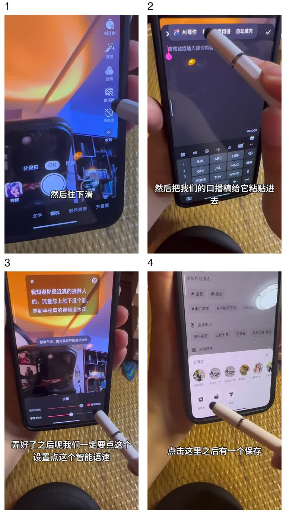

# 第5步结束时：你现在可以去拍摄了

仅在用户确认 Ancher 脚本后展示。当前聊天直接给一小段提示、四步图示和教程原链接，不再追问拍摄工具清单，不强制换掉用户现有工具。

> 脚本定稿了，你现在可以去拍摄了。有自己顺手的工具就直接用；还没选工具的话，可以试试抖音提词器，不用硬背全文。拍完把素材发回这里，我们继续剪辑。

1. **找到提词器**：复制定稿，打开抖音拍摄页，在右侧更多工具里找到提词器。
2. **粘贴脚本**：点开文字输入，粘贴Ancher Agent定稿并确认。
3. **调好再拍**：在提词器设置启用智能语速、调整字号/位置，让文字跟随讲话节奏。按需使用倒计时，优先保证画面和收音清楚。
4. **存本地**：切视频拍摄，录完进入下一步，选择存本地，再上传到当前聊天。

图示来自「无限可能的漫妮」《挑战1分钟教会所有人拍出活人感视频》操作演示：
https://xhslink.cn/o/1NpTd1Dp0En

原帖界面是2026-10-21查看的版本，不声称所有手机版本都相同。来源与时间点见 assets/shooting/SOURCE.txt。可用自己的工具，这只是其中一种拍法。

截图中虽然有“AI写作”入口，本流程只粘贴Ancher定稿；任何改稿仍回当前聊天传给Ancher Agent。

展示本地图时按宿主能力把上面的相对路径解析为实际安装目录下的绝对路径或附件。宿主无法显示图片时使用编号说明并提供原链接，不输出一个不存在的图片地址。
